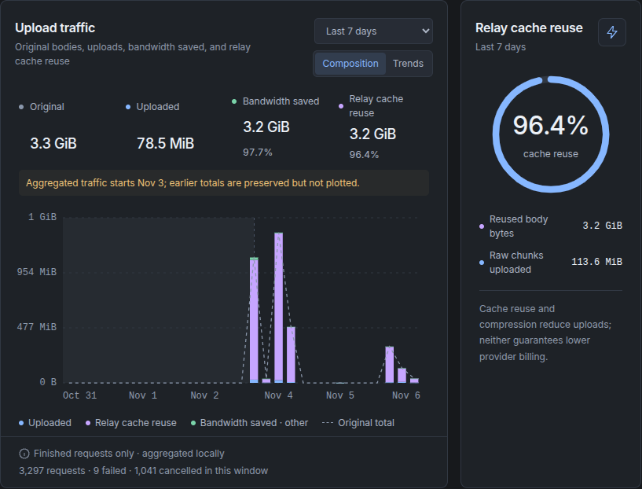
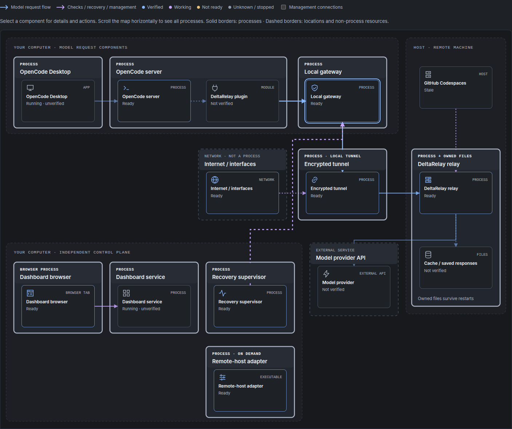

# DeltaRelay

> **AI-authored project:** Repository content is written by AI agents, and setup
> is intended for an AI agent with human oversight. Review commands, configuration,
> and security implications before deploying.

## 1 - What problem does this tool solve?

DeltaRelay is designed for people using OpenCode over **slow, upload-limited, or
unstable internet connections**, who can run a trusted remote relay while keeping
OpenCode V2 and their workspace local. It addresses two problems:

- **Repeated uploads on limited bandwidth:** conversations using stateless LLM
  APIs resend earlier context with each request, including unchanged messages,
  instructions, and tool definitions. DeltaRelay uploads only the chunks the
  remote relay is missing, plus control metadata, rather than sending all that
  unchanged content again. The relay rebuilds and verifies the exact request
  before forwarding it to the provider.
- **Interrupted response delivery:** once the relay accepts your request, it
  communicates with the model provider independently of your PC's connection and
  durably stores received response bytes. If your connection drops, generation
  can continue remotely, and your client can reconnect and resume downloading
  from the last verified byte without submitting the same request to the
  provider again.

This separates the provider connection from your unreliable local connection.
It does not make your internet faster; it reduces repeated uploads and makes
interrupted transfers recoverable. It does not summarize or modify requests,
reduce model token usage, or reduce provider billing. Benefits depend on repeated
content and the relay's connectivity, storage, and retention limits—not a
guarantee of faster responses or permanent response storage.

## 2 - Results of the proposed solution

**3.3 GiB of request bodies. 78.5 MiB uploaded.**

**97.7% less uploaded** in the dashboard's captured **Last 7 days** view below.



Actual local dashboard capture, November 7, 2026 (UTC), with rounded display
values. The chart reports finished requests only: 3,297 requests, including
9 failed and 1,041 cancelled in that window. Aggregated traffic starts November 3;
earlier totals are preserved but not plotted, so the selected range is not seven
complete days of plotted history. **This is an observed sample, not a benchmark
or a speed guarantee.**

Reduction is `1 - encoded upload bytes / original body bytes`. It combines chunk
reuse and compression, includes upload control metadata, and excludes HTTP
headers, TLS/TCP/IP overhead, responses, and network retransmissions. The baseline
is the original body, not a separately compressed direct upload. Results depend
on the workload and cache availability. **The provider still receives the full
request; this mechanism does not reduce token usage or provider billing.**
See [measurement details](docs/DASHBOARD.md).

## 3 - Why the problem exists: API behavior and evidence

**Stateless conversation APIs receive the history the client wants the model to
use in each request—not just the newest question.** Retaining that history means
uploading earlier messages again, often alongside unchanged instructions and tool
definitions. This is a documented API pattern, not a requirement of every LLM
service or client:

- **OpenAI Chat Completions** (`POST /v1/chat/completions`): the
  [official API definition][openai-history] requires `messages`, described as
  “A list of messages comprising the conversation so far.”
- **Anthropic/Claude Messages** (`POST /v1/messages`): the
  [official API definition][anthropic-history] says you specify “the prior
  conversational turns with the `messages` parameter.” Its
  [Messages documentation in the official SDK][anthropic-stateless] explicitly
  calls this “stateless multi-turn” conversation.
- **OpenCode Go:** its [official endpoint table][go-endpoints] lists
  `/inference/go/openai/v1/chat/completions` and
  `/inference/go/anthropic/v1/messages`, including the corresponding AI SDK
  packages. These are the client-supplied-history API paths described above.
  OpenCode's [V2 compaction documentation][opencode-compaction] also explicitly
  describes “Sending the full conversation” to reuse “the normal request's
  prompt cache,” and shows the system prompt and conversation in the request.
  Together, these document the repeated-context case for OpenCode using Go's
  stateless paths; they do not establish that every Go API mode resends history.

**Provider-side prompt caching is not upload deduplication.** OpenAI's
[official caching example][openai-caching] appends to the existing `messages`
array and sends it again on the second call, even with a cache hit. Go's
[session-header documentation][go-sessions] describes `x-opencode-session` as
helping routing and prompt-cache reuse, not as a replacement for request history.
DeltaRelay instead deduplicates bytes on the **PC-to-relay** connection; the relay
still forwards the complete, verified request body to the provider.

**Exceptions matter:** OpenAI Responses supports server-managed history through
[`conversation`][openai-conversation] or
[`previous_response_id`][openai-previous-response], so clients using those features
need not re-upload all earlier messages. Go also exposes Responses; its endpoint
listing alone does not prove support for every state-management feature.
OpenCode compaction replaces older context with a summary or checkpoint, so
“history” means the context selected for the current request, not necessarily
everything ever said. Savings depend on how much content is actually repeated.

Sources checked November 7, 2026. SDK and cookbook links below are pinned to the
reviewed revisions so the cited evidence does not move with their default branch.

[openai-history]: https://github.com/openai/openai-python/blob/a1175a35ba6aa2d6bf98d26088a572ab0c5f4453/src/openai/types/chat/completion_create_params.py#L41-L54
[anthropic-history]: https://github.com/anthropics/anthropic-sdk-python/blob/4c7b598466b88559583f98216139be8e9b34c1fc/src/anthropic/types/message_create_params.py#L50-L61
[anthropic-stateless]: https://github.com/anthropics/anthropic-sdk-python/blob/4c7b598466b88559583f98216139be8e9b34c1fc/src/anthropic/resources/messages/messages.py#L152-L156
[go-endpoints]: https://opencode.ai/v2/docs/console/go#endpoints
[opencode-compaction]: https://opencode.ai/v2/docs/compaction#how-it-works
[openai-caching]: https://github.com/openai/openai-cookbook/blob/2d5b1a9b6e706a732b03048d701c7086fda5f010/examples/Prompt_Caching101.ipynb
[go-sessions]: https://opencode.ai/v2/docs/console/harnesses#sessions
[openai-conversation]: https://github.com/openai/openai-python/blob/a1175a35ba6aa2d6bf98d26088a572ab0c5f4453/src/openai/types/responses/response_create_params.py#L59-L66
[openai-previous-response]: https://github.com/openai/openai-python/blob/a1175a35ba6aa2d6bf98d26088a572ab0c5f4453/src/openai/types/responses/response_create_params.py#L152-L159

## 4 - Architecture of the proposed solution

The OpenCode V2 integration keeps your UI, files, tools, sessions, and sign-ins
local. Only model requests pass through the trusted relay; responses stream back,
with no automatic direct-provider fallback.

### Request flow and integrity checks

1. **On your PC:** compute the original request body's SHA-256 and byte length,
   and split it into content-defined chunks.
2. **Across the connection:** upload only chunks the relay is missing.
3. **On the VPS/remote host:** verify the chunks, rebuild the body in order, and
   compare its SHA-256 and length with the original manifest.
4. **Only after verification:** forward the reconstructed body to the provider.
   An integrity mismatch stops the request.

### Response storage and recovery on unstable connections

```text
Local client <-- resumable transfers --> Remote relay <--> Model provider
                                        stores response bytes
```

The remote relay owns the provider connection, so a dropped PC-to-relay connection
does not cancel generation. It writes received provider bytes to checksummed,
durable storage before making them available to your client. The client fetches
and verifies response segments as they arrive; after a connection loss, downloads
resume from the last verified byte offset. Upload retries likewise send only
chunks still missing at the relay. Retrying the same logical request does not
dispatch it to the provider again.

This protects delivery from interruptions on your local connection, not from
every possible failure. Automatic transport retries have a configured window
(default one hour). Unacknowledged responses expire after the configured retention
period (default 24 hours after completion, failure, or cancellation); acknowledged
response payloads are removed. Relay failures, provider failures, runtime limits,
and storage limits can still interrupt requests. Generation may continue and
incur provider charges while your PC is offline; an offline cancellation cannot
reach the relay until reconnection. See the [protocol guarantees](docs/PROTOCOL.md#1-guarantees)
and [retention and limits](docs/PROTOCOL.md#6-retention-and-limits).

### Local workspace, remote relay, and controls



Actual dashboard map captured November 7, 2026 (UTC), using GitHub Codespaces as
the remote host. Status labels are observations at capture time—not a claim that
every connection is verified. The map distinguishes the model-request path from
checks, recovery, and management. Request content and forwarding credentials still
pass through the trusted relay. See [architecture](docs/ARCHITECTURE.md).

### Security and limitations

- Trust the remote host with request content and forwarded provider credentials.
  This is a single-tenant relay, not a shared public service.
- Use SSH or verified HTTPS. Do not expose a plaintext listener publicly.
- Cache files, temporary spools, and diagnostic captures contain plaintext.
  Dashboard request capture is enabled by default; use `--capture-dir ""` to
  disable it. See [dashboard security](docs/DASHBOARD.md).
- Keep tokens, configuration, and logs outside Git, either outside the checkout
  or in ignored `.runtime/`. Never commit secrets or place tokens in URLs.
- A cold or lost cache requires uploading missing content again. Storage is
  bounded but not automatically evicted; capacity failures stop requests rather
  than bypassing the relay.

## 5 - Instructions to install

Installation has three parts: build the local tool and dashboard, set up an
existing trusted remote host, and enable the OpenCode plugin.

### Requirements

- **Build:** Go 1.24+ in a Linux/POSIX environment.
- **Dashboard:** Python 3, Node.js 22.12+, pnpm 11+, and cached dependencies for
  [offline installation](docs/DASHBOARD.md#build-entirely-offline).
- **Launcher:** uv and an existing Python 3.14 installation; downloads are disabled.
- **Remote setup:** An existing trusted Linux amd64/arm64 host with Python 3,
  noninteractive SSH authentication, and a trusted host key. Codespaces also
  requires an authenticated current `gh` CLI and an existing Codespace.
- **OpenCode integration:** OpenCode V2, a working provider connection, and Node.js
  22+. The plugin has no npm dependencies.

### Build and first-time setup

```sh
git clone https://github.com/BritoAlv/deltarelay.git
cd deltarelay
go build -trimpath -o bin/deltarelay ./cmd/deltarelay
```

After preparing the [dashboard dependencies](docs/DASHBOARD.md), start setup:

```sh
uv run ./deltarelay start --no-desktop
```

Open **http://127.0.0.1:8790/controls → Set up remote host** and select an existing
SSH host or Codespace and a new private remote directory. Setup builds and
transfers the relay and saves private credentials and connection configuration.
It does not create machines, install system packages, or provision public TLS.
See the [remote setup guide](docs/REMOTE_SETUP.md).

Next, follow the [OpenCode setup guide](docs/SETUP.md) to enable the plugin and
verify routing. **Building the project or setting up a host does not activate the
plugin.** That guide also covers manual setup and direct HTTPS.

## 6 - Instructions to run

### Start an existing installation

After completing setup and enabling the OpenCode plugin, run the following from
your DeltaRelay checkout to start your existing deployment:

```sh
cd /path/to/deltarelay
uv run ./deltarelay start
```

By default, startup reads
`${XDG_CONFIG_HOME:-$HOME/.config}/deltarelay/supervisor.json`. If you saved your
configuration elsewhere, specify its path instead:

```sh
uv run ./deltarelay start --config /private/supervisor.json
```

Replace `/private/supervisor.json` with your actual configuration file. To start
the local controls and network recovery without launching OpenCode/Desktop, add
`--no-desktop` to either command.

Open **http://127.0.0.1:8790/controls** (or your configured dashboard address) to
check connection status. Local startup readiness does not guarantee that the
remote host is connected. You do not need to repeat remote setup for normal
startup; credentials and Desktop profiles are not included in a fresh clone.
See [supervision and controls](docs/SUPERVISION.md) for configuration and service
management details.

### Optional: quick local trial without a model account

No model account is needed. Set the **same long random token** in both terminals
(generate one with `openssl rand -hex 32`).

Terminal 1:

```sh
export DELTARELAY_TOKEN='<same-long-random-token>'
./bin/deltarelay serve --data ./data --listen 127.0.0.1:8787
```

Terminal 2, using any request-body file:

```sh
export DELTARELAY_TOKEN='<same-long-random-token>'
./bin/deltarelay sync --input request.json
./bin/deltarelay sync --input request.json
```

The second sync should report `uploaded_chunks: 0`; control metadata is still
sent. To check the reconstructed body yourself, use the `hash` returned by sync:

```sh
./bin/deltarelay fetch --hash '<hash-from-sync>' --output reconstructed.json
sha256sum request.json reconstructed.json
cmp request.json reconstructed.json
```

The SHA-256 values should match, and `cmp` should exit successfully with no output.
Use a new output path: `fetch` refuses to overwrite an existing file. Change the
input and sync again to measure reuse; use a subcommand's `-h` for options.

## Development

Run the complete offline test matrix with:

```sh
make verify
```

This requires the cached dashboard dependencies and a C compiler for Go race
tests. Tests use local services and mock providers, not real model accounts.
Installed-OpenCode tests (`make opencode-test`) and performance comparisons
(`make baseline-benchmark`) are opt-in.

## Documentation

- [OpenCode Desktop and VPS setup](docs/SETUP.md)
- [Automatic remote setup](docs/REMOTE_SETUP.md)
- [Dashboard, offline builds, and measurements](docs/DASHBOARD.md)
- [Automatic recovery and service controls](docs/SUPERVISION.md)
- [Architecture](docs/ARCHITECTURE.md)
- [Protocol, storage, limits, and recovery](docs/PROTOCOL.md)
- [Remote-host providers](docs/REMOTE_PROVIDERS.md)
- [Recovery acceptance testing](docs/RECOVERY_TESTING.md)

## Limitations

### Client integration

DeltaRelay is currently designed for **OpenCode V2, including OpenCode Desktop**.
The installation instructions and plugin integration target these clients.

The relay's underlying protocol is provider-independent, but that does **not**
make it a drop-in replacement for every coding agent or chat interface. Clients
such as **Claude Code, Codex CLI, and Pi** could potentially use the same approach,
but would need a compatible integration that routes their requests through
DeltaRelay and correctly handles response delivery, authentication, streaming,
and recovery.

**Compatibility with these other clients is not currently established.** Do not
assume that changing their provider URL alone is sufficient.
